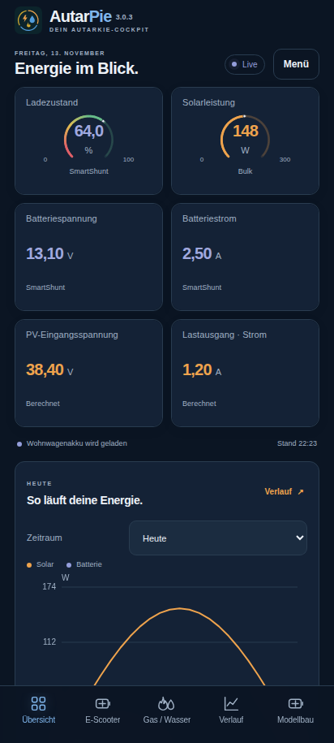
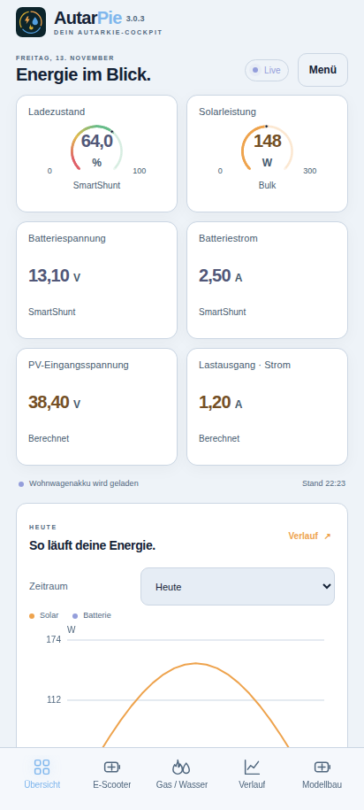
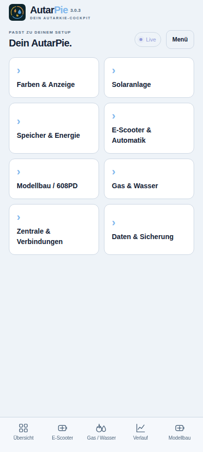
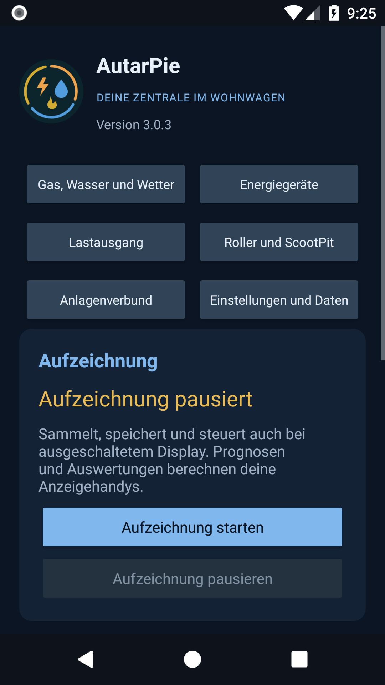

# AutarPie 3.0.3

**Das lokale Cockpit für autarkes Leben.** Solar und Stromverteilung, Wohnwagenakku, E-Scooter, Modellbau, Gas und Wasser in einer gemeinsamen App. AutarPie führt **Watt’n’Pit und WohnPit** weiter.

**[AutarPie 3.0.3 als APK herunterladen](https://github.com/Tim-Gurke/AutarPie/releases/download/v3.0.3/AutarPie-v3.0.3.apk)** · [Einrichtung und Bedienung](docs/AUTARPIE-3.md) · [Update und Prüfgrenzen](docs/changes-3.0.3.md) · [Vollständige Versionshistorie](CHANGELOG.md)

Android 8 oder neuer; das Cockpit benötigt einen aktuellen Android-System-WebView. Kein Konto, keine Werbung. Mess- und Lerndaten bleiben auf den eigenen Geräten. Der optionale Wetterabruf verwendet Open-Meteo. Der Anlagenverbund überträgt Daten verschlüsselt im lokalen WLAN.

## Das Cockpit

| Dunkel | Hell |
| --- | --- |
|  |  |

Die Aufnahmen zeigen die tatsächliche geprüfte Oberfläche mit erfundenen Messwerten. Kacheln und Bereichsfarben sind einstellbar; vorhandene eigene Anordnungen werden nicht pauschal ersetzt.

| Einstellungsbereiche | Native Zentrale |
| --- | --- |
|  |  |

## Ein Cockpit, mehrere Anwendungen

- **Übersicht:** frei zusammenstellen, was gerade gebraucht wird – auch Werte aus E-Scooter, Modellbau, Gas und Wasser.
- **Solar & Speicher:** Anlage, Batteriebilanz, PV-Spannung, Lastausgang, Wetter und Prognose.
- **E-Scooter:** BMS-Werte, Speicherinhalt, Ladeweg, Ladeplanung und Sondernutzung.
- **Gas / Wasser:** Beschaffungen, Flaschenwechsel, korrigierter Vorrat und gelernter Bedarf.
- **Modellbau:** 608PD-Livewerte, begrenzte bestätigte Bedienfunktionen und Einordnung externer Batterieladung.
- **Verlauf, Geräte, Einstellungen:** Messungen, Phasenzeitleiste, Verbindungen und gemeinsame Konfiguration.

Alle Bereiche sind oben über **Menü** erreichbar. Untere Kurzwahlen lassen sich ein-/ausblenden und ordnen; Ziehen und Pfeile zeigen die neue Reihenfolge sofort im Dialog. Android-Zurück führt durch die geöffneten Einstellungs- und Menüebenen. Eigene benannte Dashboards können leer beginnen oder eine vorhandene Ansicht kopieren. Raster, Kachelgrößen und Hoch-/Queranordnungen bleiben gerätelokal. Kachelentfernen fragt nach; die Darstellungsgröße verlangt ausdrückliches Speichern.

Gemeinsame Bereichsfarben und weiche zwei-/dreifarbige Skalen sind zentral einstellbar. App- und Kachelhintergründe unterstützen eine oder zwei Farben mit Verlaufwinkel 0–360°. Einzelne Kacheln dürfen davon abweichen. Optional erhält jedes Dashboard ein eigenes Farbdesign. Die Farbauswahl startet beim aktuellen Farbton und bietet App-Farben sowie automatisch gemerkte eigene Mischfarben.

## Zentrale, Anzeige oder eigenständig

| Rolle | Aufgabe |
| --- | --- |
| Zentrale | Mess- und Wettergrundlagen erfassen, speichern und verteilen; native Bedienoberfläche und bestätigte Steuerung |
| Anzeigehandy | Cockpit, Diagramme, Prognosen, Verbrauchslernen und eigene Dashboards aus den Zentraldaten berechnen |
| Eigenständig | Erfassung, Berechnung, Planung und Cockpit auf einem Gerät ohne Zentrale |

Autostart stellt nach Neustart oder App-Update den gespeicherten Zustand wieder her. Eine pausierte Aufzeichnung bleibt pausiert. Das konkrete Android-Gerät kann erstes Entsperren und zusätzliche Hintergrund-/Bluetooth-Freigaben verlangen. Gemeinsame Zentralfunktionen sind auch von den Anzeigehandys bedienbar, einschließlich Archivabruf und Aufzeichnung.

## Solar, Lastausgang und 608PD

Standort, Aufstellung, Verschattung, Module, Verkabelung und Regler werden gemeinsam eingerichtet. Solarkreise behalten beim Umordnen ihre Kennung und historischen Daten. Mehrere Kreise an demselben Regler teilen sich in der Prognose die eingetragene Strom-/Leistungsgrenze. Jeder mobile Kreis erhält einen eigenen anklickbaren Namen in der Wetterkarte.

Der SmartSolar-Lastausgang ist E-Scooter, Modellbau oder einem anderen Verbraucher zuordenbar. Zustand, Modus, Spannung, Strom und Abschaltgrund werden soweit unterstützt vom Gerät gelesen; Leistung und Energie daraus auf der Anzeige ausgewertet. Regler je Kachel wählen; aktuelle und historische Werte bleiben getrennt. Werte werden nicht nochmals zum bereits am Shunt erfassten Verbrauch addiert.

Die **optionale Rollerautomatik ist zunächst aus**. Ladeziel, Wohnwagenreserve, Tagesziel, Überschussschwellen und Prognosereserve sind variabel. Ein aktives Anzeigehandy erstellt den zeitlich begrenzten Plan; die Zentrale kontrolliert direkte Abschaltbedingungen. Ein Schaltauftrag ist erst mit der tatsächlichen Geräteantwort bestätigt. Ohne gültigen Plan wird zum Ausschalten angefordert. BMS-Empfang allein beweist noch keinen eingesteckten Ladestecker.

Der 608PD erhält eine private Verbindung aus der eigenen Bluetooth-Aufzeichnung. Unterstützt sind nachgewiesene Livefelder und Beenden von Laden/Powerbank-Betrieb. App-Start ist zunächst auf das beobachtete **3S-LiPo-Profil 4,21 V/Zelle / 0,50 A** mit ausdrücklicher Profilbestätigung begrenzt. Powerbank und andere Profile am Gerät starten. Nicht belegte Temperatur-/USB-/CC-CV-Felder werden nicht erfunden.

## Hotfix 3.0.3

Farben bleiben beim Seitenwechsel der richtigen Seite zugeordnet. „Verlauf“ übernimmt ohne eigenes Design die gemeinsamen Vorgaben; sein Hintergrund hängt nicht mehr davon ab, ob zuvor Übersicht, Solar oder ein eigenes Dashboard geöffnet war. „Farben dieses Dashboards“ bearbeitet die sichtbare Seite. Speichern, Abbrechen und ein fehlgeschlagener Speicherversuch verändern keine anderen Dashboards oder deren Kacheln. Eigene Verlaufsfarben gelten auch für seine Diagramme.

**Über die vorhandene App aktualisieren.** Die Zentralen-Korrektur aus 3.0.2 ist enthalten. Bei einer Zentrale mit 3.0.1 oder älter zuerst die Zentrale aktualisieren; eine Zentrale mit 3.0.2 bleibt mit den neuen Anzeigehandys kompatibel. [Hotfix und Prüfgrenzen 3.0.3](docs/changes-3.0.3.md) · [Zentralen-Hotfix 3.0.2](docs/changes-3.0.2.md) · [Umfang 3.0.1](docs/changes-3.0.1.md).

## Update von WohnPit

1. Vollständige private Sicherung anlegen.
2. **Zuerst die Zentrale, danach die Anzeigehandys auf 3.0.3** aktualisieren.
3. Die APK über die vorhandene gemeinsame App installieren, **nicht deinstallieren**.

Name und Symbol ändern sich; Paket `de.wattpit.app`, Original-Updatesignatur, gespeicherte Daten, Kopplungen und ScootPit-Schnittstelle bleiben erhalten. Das bestehende Repository heißt seit dem 13.11.2026 [`Tim-Gurke/AutarPie`](https://github.com/Tim-Gurke/AutarPie). Die Umbenennung erfordert keine Neuinstallation. Ein bereits abgeschlossener Umzug aus der alten separaten WohnPit-Zentrale muss nicht wiederholt werden.

Nur beim bisherigen separaten Paket `de.wohnpit.app` ist die alte [Umzugsanleitung](docs/ZUSAMMENFUEHRUNG.md) relevant. Das notwendige signierte Hilfsprogramm bleibt als `WohnPit-Uebernahme-v0.0.5.apk` im aktuellen Release verfügbar. Private Umzugs- und Signierdateien werden niemals veröffentlicht.

## Gas, Wasser, Datenschutz und Prüfungen

Beschaffungen und Flaschenwechsel bilden den Lernverbrauch. Eine reine Inhaltskorrektur korrigiert Vorrat/Reichweite und gilt nicht als neuer Verbrauch. Kanister- und Flaschengrößen sind einstellbar. [Gas und Wasser im Detail](docs/GAS-WASSER.md).

Geprüft werden Berechnungen, Daten-/Konfigurationsübernahme, echte TCP-/SQLite-Verbundabläufe, Browserbedienung und Android-Oberfläche. Reale Funkverbindungen, Autostart am vorhandenen G5 sowie Schalt- und Ladevorgänge mit den konkreten Geräten müssen vor Ort bestätigt werden; Softwareprüfungen ersetzen diese nicht. [Prüfumfang und Grenzen](docs/changes-3.0.3.md).

Die App übernimmt keine Geräte-Firmwareupdates. Solche Updates und übrige Geräteparameter bleiben in der jeweiligen Hersteller-App. Geräteschlüssel bleiben auf dem erfassenden Gerät; der lokale Verbund verwendet einen privaten Verbindungscode.

© 2026 Tim Weißbach und Mitwirkende.
