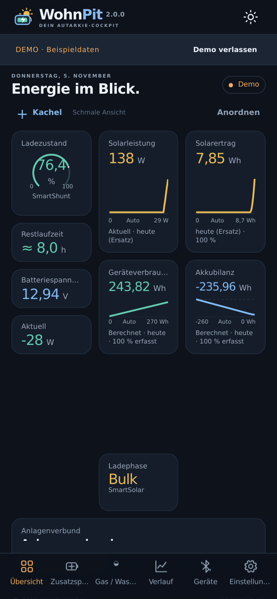
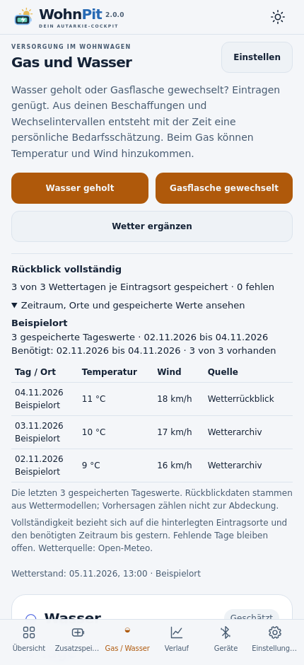
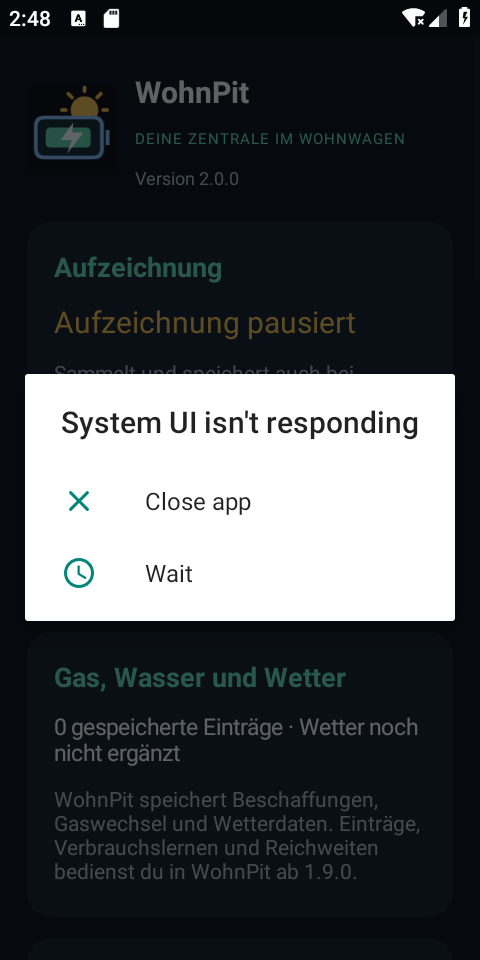
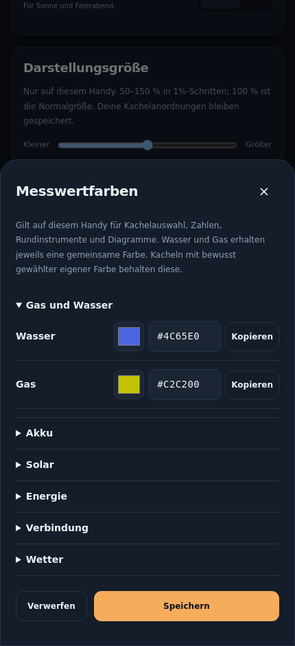

# WohnPit 2.0.1

**Dein lokales Cockpit für Energie, Gas und Wasser.** Solar, Akku, Verbrauch und Versorgung im Blick – im Wohnwagen, Ferienhaus, Gartenhaus und an passenden Balkonanlagen.

**[WohnPit 2.0.1 herunterladen](https://github.com/Tim-Gurke/WohnPit/releases/download/v2.0.1/WohnPit-v2.0.1.apk)** · [Projektseite](https://wohnpit.extraordinarygrove.chatgpt.site) · [Installieren, einrichten und umziehen](docs/ZUSAMMENFUEHRUNG.md) · [Versionshistorie](CHANGELOG.md)

**Neu in 2.0.1:** Anzeigehandys laden ihren ersten Statistikstand auch während die Zentrale weiter aufzeichnet. Solarertrag, Verbrauch und Diagramme werden schrittweise sichtbar, statt durch neue Livewerte immer wieder verworfen zu werden. [Update und Prüfung auf dem Anzeigehandy](docs/ANZEIGE-STATISTIK.md) · [Änderungen und Prüfgrenzen](docs/changes-2.0.1.md).

WohnPit vereint die bisherigen Apps Watt’n’Pit und WohnPit. **Android 8+**, für das Cockpit mit aktuellem Android-System-WebView. Kein Konto, keine Werbung. Messdaten bleiben auf deinen Geräten; optionaler Wetterabruf nutzt Internet. Im Anlagenverbund werden Daten verschlüsselt im lokalen WLAN übertragen.

## Ein Handy oder mehrere: du entscheidest

| Betriebsart | Aufgabe |
|---|---|
| **Zentrale** | Geräte auslesen, Aufzeichnungen und Journal speichern, Wetter sammeln, weitere Handys versorgen. Schlanke native Oberfläche für das G5; kein Dashboard-WebView. |
| **Anzeigehandy** | Eine Zentrale koppeln, Kacheln und Verläufe anzeigen, rechnen und lernen, Anlage und Versorgung bedienen. |
| **Eigenständig · Victron direkt** | Ohne Zentrale direkt mit den Victron-Geräten verbinden. Aufzeichnung, Wetter, Berechnung und Anzeige auf einem Handy. |

Beim ersten Start auswählen; bestehende Watt’n’Pit-Installationen übernehmen ihre bisherige Rolle. Die Betriebsart lässt sich später ändern. Der Verbund braucht dasselbe lokale WLAN. Ein automatischer Fernzugriff über das Internet ist nicht enthalten.

## Was du im Cockpit siehst

Solarleistung und -ertrag, Akkustand, Batterie- und Energiebilanz, Verbrauch, Gerätearchive, Wetter und Planung. Freie Kacheln mit Zahlen, Rundinstrumenten oder Kurven, getrennten Anordnungen für Hoch-/Querformat und zentralen Farben mit kopierbaren Hexcodes. Wasserbeschaffungen und Gaswechsel manuell eintragen; daraus Bedarf, Restvorrat und Reichweite in **Tagen und Stunden** schätzen. Fehlende Werte bleiben unbekannt.

| Cockpit mit Beispieldaten | Nachvollziehbarer Wetterrückblick |
|---|---|
|  |  |

| Schlanke Zentrale im Android-Emulator | Zentrale Messwertfarben |
|---|---|
|  |  |

Alle Aufnahmen zeigen Demo-, Beispiel- oder Emulatoransichten. Keine persönlichen Messwerte oder Verknüpfungen werden veröffentlicht.

## Von den bisherigen Apps wechseln

**Watt’n’Pit auf dem Anzeigehandy:** Die neue WohnPit-APK über Watt’n’Pit installieren, ohne vorher zu deinstallieren. Die Updatesignatur und technische App-Kennung bleiben erhalten. Der sichtbare Name wird WohnPit; die vorhandenen Daten und Kopplungen bleiben erhalten.

**Bisherige WohnPit-Zentrale:** zuerst **[WohnPit 0.0.5 · Übernahme](https://github.com/Tim-Gurke/WohnPit/releases/download/v0.0.5/WohnPit-v0.0.5.apk)** installieren, Aufzeichnung/Archivabruf pausieren und eine vollständige verschlüsselte Sicherung erstellen. Danach in der aktuellen gemeinsamen WohnPit-App einlesen, prüfen lassen, schließen und neu öffnen. Die alte Übernahme-App bis zur Kontrolle behalten. Geräte und Anzeigehandys nötigenfalls neu verknüpfen. [Schritt-für-Schritt-Anleitung](docs/ZUSAMMENFUEHRUNG.md).

**Private Umzugsdateien niemals veröffentlichen.** Sie enthalten Geräte- und Verbindungsschlüssel und werden mit deinem eigenen Kennwort verschlüsselt. Die App speichert das Kennwort nicht und lädt die Datei nicht auf einen Server. Die öffentliche APK ist keine Umzugsdatei. Normale CSV- oder Einstellungsexporte ersetzen die vollständige Übernahmesicherung nicht.

**Layout-Hinweis:** Auf Wunsch wird beim Update einmal die gespeicherte Anordnung mit 20 Kacheln für beide Ausrichtungen übernommen und ersetzt die bisherige lokale Anordnung. Bei Bedarf vorher das alte Layout exportieren. Spätere Änderungen werden nicht erneut überschrieben. Wasser verwendet **#4C65E0**, Gas **#C2C200**. [Farben und Wetterrückblick ausführlich erklärt](docs/MESSWERTFARBEN-WETTER.md).

## Geeignete Geräte und Anlagen

Die Bluetooth-Energieanzeige nutzt unterstützte Victron SmartSolar-/SmartShunt-Geräte mit Sofortanzeige und passenden Geräteschlüsseln. Der Aufstellort kann Wohnwagen, Ferienhaus, Gartenhaus oder Balkon sein; beliebige Wechselrichter und Netzstromzähler werden dadurch nicht automatisch unterstützt. Weitere vorhandene Speicherfunktionen und die signaturgeprüfte ScootPit-BMS-Übergabe bleiben erhalten. ScootPit braucht für die Zusammenführung kein Update.

**WohnPit ersetzt VictronConnect nicht.** Geräteeinstellungen und Firmware-Updates von Regler und Shunt weiterhin in VictronConnect vornehmen. WohnPit ist ein unabhängiges Projekt, kein offizielles Victron-Produkt.

## Anleitung und vollständige Historie

- [Ausführliche Cockpit-Bedienung](docs/COCKPIT-ANLEITUNG.md)
- [Installation, Betriebsarten, Geräte und vollständiger Umzug](docs/ZUSAMMENFUEHRUNG.md)
- [Messwertfarben, Layout und belegter Wetterrückblick](docs/MESSWERTFARBEN-WETTER.md)
- [Gas und Wasser: Einträge, Wetter und Schätzungen](docs/GAS-WASSER.md)
- [Statistiken und Diagramme auf Anzeigehandys](docs/ANZEIGE-STATISTIK.md)
- [Änderungen und Prüfgrenzen 2.0.1](docs/changes-2.0.1.md)
- [Änderungen und Prüfgrenzen 2.0.0](docs/changes-2.0.0.md)
- [Übernahmeversion 0.0.5](docs/changes-0.0.5.md)
- [WohnPit-Versionshistorie](CHANGELOG.md) und [bisherige Watt’n’Pit-Versionshistorie](https://github.com/Tim-Gurke/Watt-n-Pit/blob/main/CHANGELOG.md)

Je Repository bleiben die drei neuesten Releases veröffentlicht. Tags, Quellhistorie und Änderungsdokumentation bleiben erhalten.

## Entwicklung

JDK 17, Android SDK 35 und Gradle 8.11.1. Vor jedem Hochladen **nach dem Vormerken der Änderungen** die öffentliche Dateiliste prüfen:

```bash
python3 tools/check-public-files.py
python3 tools/check-upstream.py
node --test tools/*test.cjs
./gradlew testDebugUnitTest lintDebug assembleDebug assembleDebugAndroidTest assembleRelease
```

Die bestehende Watt’n’Pit-Updatesignatur wird technisch weiterverwendet: `WATTPIT_KEYSTORE`, `WATTPIT_SIGNING_PASSWORD`, Alias `wattpit`. Schlüssel gehören ausschließlich in die private Bauumgebung. Der GitHub-Veröffentlichungslauf übernimmt eine bereits signierte APK und prüft Quelle, erfolgreichen Prüflauf, Dateigröße und Prüfsumme; er erhält keine privaten Signierschlüssel.

Herkunft und überprüfte Änderungen stehen in [UPSTREAM.json](UPSTREAM.json). Lizenz: [MIT](LICENSE). © Tim Weißbach.
