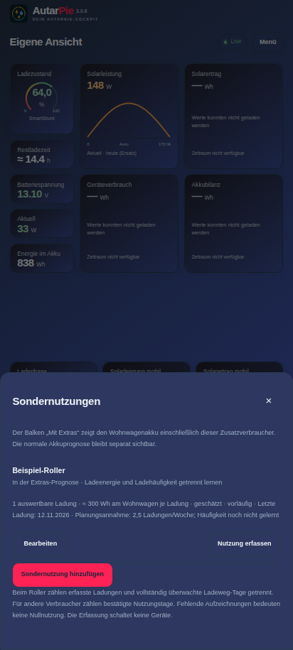
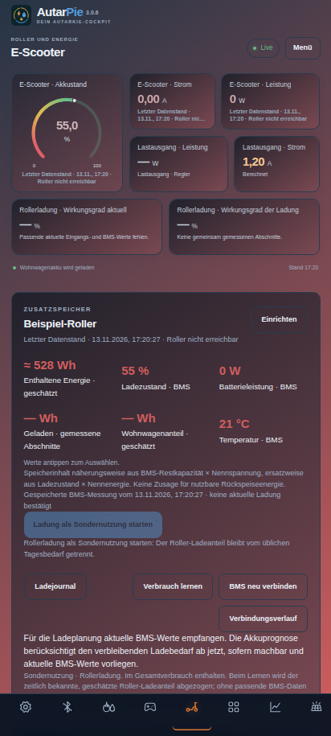

# AutarPie 3.0.6

**Das lokale Cockpit für autarkes Leben.** Solar und Stromverteilung, Wohnwagenakku, E-Scooter, Modellbau, Gas und Wasser in einer gemeinsamen App. AutarPie führt **Watt’n’Pit und WohnPit** weiter.

**[AutarPie 3.0.6 als APK herunterladen](https://github.com/Tim-Gurke/AutarPie/releases/download/v3.0.6/AutarPie-v3.0.6.apk)** · [Einrichtung und Bedienung](docs/AUTARPIE-3.md) · [Update und Prüfgrenzen](docs/changes-3.0.6.md) · [Vollständige Versionshistorie](CHANGELOG.md)

Android 8 oder neuer; das Cockpit benötigt einen aktuellen Android-System-WebView. Kein Konto, keine Werbung. Mess- und Lerndaten bleiben auf den eigenen Geräten. Der optionale Wetterabruf verwendet Open-Meteo. Der Anlagenverbund überträgt Daten verschlüsselt im lokalen WLAN.

## Ansichten

| Rollerbedarf lernen | Gemeinsame Kurzwahl-Akzentfarbe |
| --- | --- |
|  |  |

Die Aufnahmen zeigen die geprüfte Oberfläche mit neutralen Beispieldaten und einem ausdrücklich als gespeichert gekennzeichneten BMS-Stand. Eigene Farben und Layouts bleiben erhalten. [Native Zentrale in 3.0.6](docs/images/autarpie-3.0.6-central.svg).

## Ein Cockpit, mehrere Anwendungen

- **Übersicht:** frei zusammenstellen, was gerade gebraucht wird – auch Werte aus E-Scooter, Modellbau, Gas und Wasser.
- **Solar & Speicher:** Anlage, Batteriebilanz, PV-Spannung, Lastausgang, Wetter und Prognose.
- **E-Scooter:** BMS-Werte, Speicherinhalt, Ladeweg, Ladeplanung und Sondernutzung.
- **Gas / Wasser:** Beschaffungen, Flaschenwechsel, korrigierter Vorrat und gelernter Bedarf.
- **Modellbau:** 608PD-Livewerte, begrenzte bestätigte Bedienfunktionen und Einordnung externer Batterieladung.
- **Verlauf, Geräte, Einstellungen:** Messungen, Phasenzeitleiste, Verbindungen und gemeinsame Konfiguration.

Alle Bereiche sind oben über **Menü** erreichbar. Untere Kurzwahlen lassen sich ein-/ausblenden und ordnen; Ziehen und Pfeile zeigen die neue Reihenfolge sofort im Dialog. Android-Zurück führt durch die geöffneten Einstellungs- und Menüebenen. Eigene benannte Dashboards können leer beginnen oder eine vorhandene Ansicht kopieren. Raster, Kachelgrößen und Hoch-/Queranordnungen bleiben gerätelokal. Kachelentfernen fragt nach; die Darstellungsgröße verlangt ausdrückliches Speichern.

Gemeinsame Bereichsfarben und weiche zwei-/dreifarbige Skalen sind zentral einstellbar. App- und Kachelhintergründe unterstützen eine oder zwei Farben mit Verlaufwinkel 0–360°. Einzelne Kacheln dürfen davon abweichen. Optional erhält jedes Dashboard ein eigenes Farbdesign. Die Farbauswahl startet beim aktuellen Farbton und bietet App-Farben sowie automatisch gemerkte eigene Mischfarben.

## Zentrale, Anzeige oder eigenständig

| Rolle | Aufgabe |
| --- | --- |
| Zentrale | Mess- und Wettergrundlagen erfassen, speichern und verteilen; native Bedienoberfläche und bestätigte Steuerung |
| Anzeigehandy | Cockpit, Diagramme, Prognosen, Verbrauchslernen und eigene Dashboards aus den Zentraldaten berechnen |
| Eigenständig | Erfassung, Berechnung, Planung und Cockpit auf einem Gerät ohne Zentrale |

Autostart stellt nach Neustart oder App-Update den gespeicherten Zustand wieder her. Eine pausierte Aufzeichnung bleibt pausiert. Das konkrete Android-Gerät kann erstes Entsperren und zusätzliche Hintergrund-/Bluetooth-Freigaben verlangen. Gemeinsame Zentralfunktionen sind auch von den Anzeigehandys bedienbar, einschließlich Archivabruf und Aufzeichnung.

## Solar, Lastausgang und 608PD

Standort, Aufstellung, Verschattung, Module, Verkabelung und Regler werden gemeinsam eingerichtet. Solarkreise behalten beim Umordnen ihre Kennung und historischen Daten. Mehrere Kreise an demselben Regler teilen sich in der Prognose die eingetragene Strom-/Leistungsgrenze. Jeder mobile Kreis erhält einen eigenen anklickbaren Namen in der Wetterkarte.

Der SmartSolar-Lastausgang ist E-Scooter, Modellbau oder einem anderen Verbraucher zuordenbar. Zustand, Modus, Spannung, Strom und Abschaltgrund werden soweit unterstützt vom Gerät gelesen; Leistung und Energie daraus auf der Anzeige ausgewertet. Regler je Kachel wählen; aktuelle und historische Werte bleiben getrennt. Werte werden nicht nochmals zum bereits am Shunt erfassten Verbrauch addiert.

Die **optionale Rollerautomatik ist zunächst aus**. Ladeziel, Wohnwagenreserve, Tagesziel, Überschussschwellen und Prognosereserve sind variabel. Ein aktives Anzeigehandy erstellt den zeitlich begrenzten Plan; die Zentrale kontrolliert direkte Abschaltbedingungen. Ein Schaltauftrag ist erst mit der tatsächlichen Geräteantwort bestätigt. Ohne gültigen Plan wird zum Ausschalten angefordert. BMS-Empfang allein beweist noch keinen eingesteckten Ladestecker.

Der 608PD erhält eine private Verbindung aus der eigenen Bluetooth-Aufzeichnung. Unterstützt sind nachgewiesene Livefelder und Beenden von Laden/Powerbank-Betrieb. App-Start ist zunächst auf das beobachtete **3S-LiPo-Profil 4,21 V/Zelle / 0,50 A** mit ausdrücklicher Profilbestätigung begrenzt. Powerbank und andere Profile am Gerät starten. Nicht belegte Temperatur-/USB-/CC-CV-Felder werden nicht erfunden.

## Update 3.0.6

Der Roller kann aus kurzen ausreichend vollständig erfassten Ladungen lernen, obwohl er den übrigen Tag außer Reichweite ist. Energie je Ladung und Ladehäufigkeit bleiben getrennt. Nur vollständig überwachte Ladeweg-Tage oder geeignete bekannte Tage belegen die Häufigkeit; eine Funklücke ist keine Nullnutzung. Eine ausdrücklich gekennzeichnete Wochen- oder eigene Tagesannahme kann überbrücken, bis genügend Grundlagen vorliegen. Bei Rückkehr ersetzt eine konkret geplante Ladung aus frischen BMS-Werten die pauschale Annahme für denselben Zeitraum.

**E-Scooter → Verbrauch lernen** zeigt die Grundlage und führt zur vorläufigen Wochenannahme. Alle ausgewählten Kurzwahlen einschließlich eigener Dashboards verwenden die gemeinsame App-Akzentfarbe; sie bleibt beim Umordnen, bei Farbänderungen und abweichendem Dashboard-Design erhalten. Der historische Haushaltsabgleich aus 3.0.5 bleibt enthalten.

**Zuerst die Zentrale, danach alle Anzeigen auf 3.0.6 aktualisieren.** Über die vorhandene Installation installieren und anschließend den ersten Abgleich abwarten. Daten, Ladejournal, Kopplungen und Layouts bleiben erhalten. [Änderungen, Bedienung und Prüfgrenzen 3.0.6](docs/changes-3.0.6.md) · [Historisches Verbrauchslernen 3.0.5](docs/changes-3.0.5.md) · [Vollständige Historie](CHANGELOG.md).
