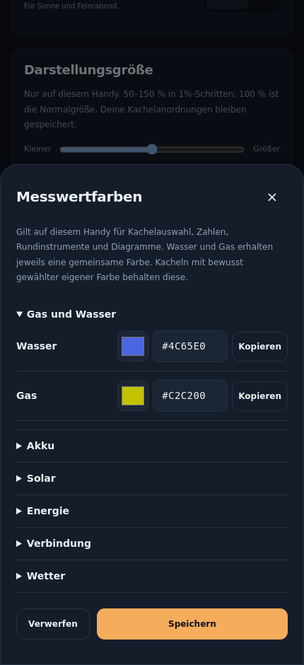
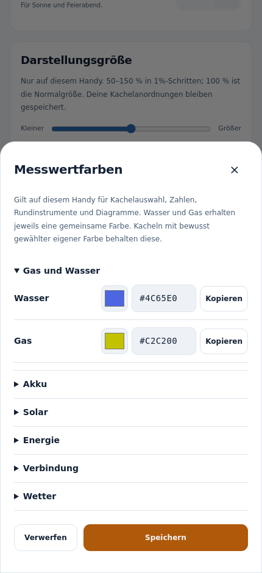
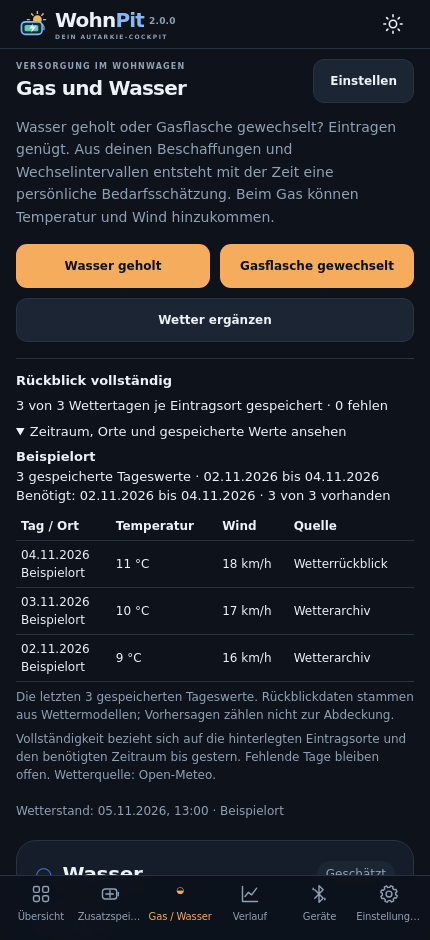
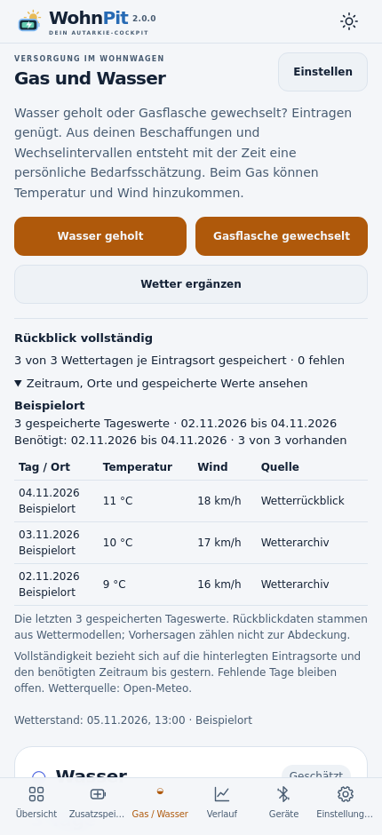

# Messwertfarben, Kachelanordnung und Wetterrückblick ab 2.0.0

## Installation

WohnPit 2.0.0 über die vorhandene App installieren; vorher nicht deinstallieren. Die Updatesignatur bleibt erhalten. Während des Übergangs bleibt die bisherige WohnPit-Zentrale ab 0.0.4 für diese Anzeigeverbesserungen kompatibel. Für die vollständige Zusammenführung zuerst mit 0.0.5 sichern und nach der Umzugsanleitung vorgehen. Für Gas/Wasser mit älteren Zentralen zuerst WohnPit auf mindestens 0.0.4 aktualisieren.

**Einmalige Layoutübernahme:** Dieses Update übernimmt die ausdrücklich gewünschte Anordnung mit 20 Kacheln einschließlich Wasser- und Gaskacheln, getrennt für schmale und breite Ansicht. Dabei wird die bisherige lokale Anordnung einmal ersetzt. Wer sein bisheriges Layout zusätzlich behalten möchte, exportiert vor dem Update die Einstellungen. Spätere Änderungen werden beim nächsten Start nicht erneut überschrieben. Messdaten, Geräte, Schlüssel und Verbundkopplungen werden durch die Layoutvorlage nicht importiert oder ersetzt.

Die Wasservorratsskala reicht in der Vorlage bis 40 L, die Gasvorratsskala bis 11 kg. Unbekannte Vorräte bleiben unbekannt; sie werden durch die Vorlage nicht als gefüllt angenommen. Gas-/Wasserreichweiten erscheinen weiter in Tagen und Stunden.

## Farben zentral festlegen

1. **Einstellungen → Messwertfarben → Messwertfarben einstellen** öffnen.
2. Unter **Gas und Wasser** je eine Farbe für alle zugehörigen Messwerte wählen. Weitere Messwerte stehen nach Akku, Solar, Energie, Verbindung und Wetter geordnet bereit.
3. Farbfeld antippen oder einen Hexcode mit sechs Zeichen eingeben, zum Beispiel **#4C65E0**. Das führende # ist bei der Eingabe optional. Der angezeigte Code ist kopierbar.
4. **Speichern** übernimmt die Zuordnung. **Verwerfen** schließt ohne Änderung. Ein ungültiger Farbcode verhindert das Speichern.

| Bereich | Übernommener Farbcode |
|---|---|
| Wasser | #4C65E0 |
| Gas | #C2C200 |
| Solarleistung und Solarertrag | #E8BB57 |
| Akkustand und Geräteverbrauch | #65CBB0 |
| Berechnete Akkubilanz | #81BAF4 |

Die Zuordnung gilt für die Kachelauswahl und alle Kacheln, die **Zentrale Messwertfarbe** verwenden, einschließlich Rundinstrument, Zahl, Verlauf und Detailansicht. Die Instrument- und Kurvenfarbe entspricht dem gespeicherten Hexcode. Text wird bei Bedarf für die Lesbarkeit im hellen oder dunklen Design angepasst. Mehrfarbige Instrumente verwenden zusätzlich ihre eingestellten Mittel- und Endfarben.

Für eine bewusste Ausnahme die Kachel anpassen und unter **Farben & Schrift → Farbzuordnung → Eigene Kachelfarbe** wählen. Wert-, Hintergrund-, Mittel- und Endfarbe besitzen ebenfalls ein sichtbares Hexfeld und eine Kopierfunktion. Zur gemeinsamen Zuordnung zurückkehren, indem wieder **Zentrale Messwertfarbe** gewählt wird.

Die Farben sind Darstellungseinstellungen **dieses Handys**, wie seine Kachelanordnung. Sie werden nicht ungefragt auf die anderen Anzeigehandys übertragen. Unter **Einstellungen → Einstellungen sichern** lassen sie sich zusammen mit dem Layout exportieren und importieren. Die Datenzentrale braucht für diese Darstellung keine neue Version.

| Dunkles Design | Helles Design |
|---|---|
|  |  |

## Erkennen, ob historische Wetterdaten geladen wurden

**Gas / Wasser → Rückblickanzeige** öffnen. Der **Wetterstand** bleibt der letzte Abrufzeitpunkt. Die zusätzliche Anzeige prüft tatsächlich gespeicherte Temperatur-/Wind-Tageswerte nach Quelle, Ort und Zeitraum:

- **Rückblick vollständig:** Alle für den prüfbaren Zeitraum bis gestern benötigten Tageswerte der hinterlegten Eintragsorte sind gespeichert.
- **Wettertage fehlen:** Anzahl vorhandener und fehlender Tage; ein aktueller Abrufzeitpunkt allein beseitigt diese Lücken nicht.
- **Eintragsort fehlt:** Zurückliegende Einträge ohne Wetterort verhindern eine vollständige Bestätigung.
- **Rückblick noch nicht prüfbar:** Die Zeitzone des gespeicherten Archivs fehlt noch. Nach einem erfolgreichen Wetterabruf erneut prüfen.
- **Noch kein Rückblick aus Einträgen benötigt:** Noch kein zurückliegender Eintrag verlangt einen Rückblick. Bereits gespeicherte Tage können trotzdem vorhanden sein.

**Zeitraum, Orte und gespeicherte Werte ansehen** aufklappen. Je Ort erscheinen der gespeicherte und benötigte Zeitraum, die Zahl vorhandener Tage und bis zu 14 fehlende Datumsangaben. Die Tabelle zeigt die letzten 30 gespeicherten Tageswerte mit Temperatur, Wind und Quelle. Bei mehreren Orten zählt ein Tag je Ort, nicht nur einmal insgesamt.

Für diese Prüfung beginnt der benötigte Zeitraum beim ersten zurückliegenden Gas-/Wassereintrag des jeweiligen Ortes und endet gestern. Der automatische Rückblick ist auf die letzten drei Jahre begrenzt; ältere Einträge werden ausdrücklich nicht als vollständig bestätigt. Ein gespeicherter Tageswert entspricht dem vom Sammler gelieferten Tagesdatensatz, nicht dem Beleg einer lückenlosen stündlichen Stationsmessung. Die Quellen **Wetterarchiv** und **Wetterrückblick** stammen von Open-Meteo und beruhen auf Wettermodellen. **Vorhersagen und heutige/zukünftige Tage zählen nicht als historische Abdeckung.**

Bei fehlenden Tagen **Wetter ergänzen** antippen. Das G5 lädt die Daten; der Abruf benötigt Internet an der Zentrale. Große Rückblicke können mehrere Abrufe benötigen. Laufender Abruf, Fehler und eine nicht erreichbare Zentrale werden weiterhin sichtbar angezeigt. Bereits gespeicherte Werte bleiben erhalten. Die Vollständigkeitsanzeige ersetzt keine Prüfung, ob ein alter Eintrag dem richtigen damaligen Standort zugeordnet wurde.

| Dunkles Design | Helles Design |
|---|---|
|  |  |

Alle Screenshots zeigen frei erfundene Beispieldaten.

## Gemeinsame App und private Übernahme

WohnPit 2.0.0 enthält Zentrale, Anzeigehandy und eigenständigen Victron-Betrieb in einer App. Die [Umzugs- und Einrichtungsanleitung](ZUSAMMENFUEHRUNG.md) erklärt den Wechsel aus den bisherigen Apps. Persönliche Übernahmedateien bleiben privat und gehören niemals auf GitHub oder die Projektseite.
