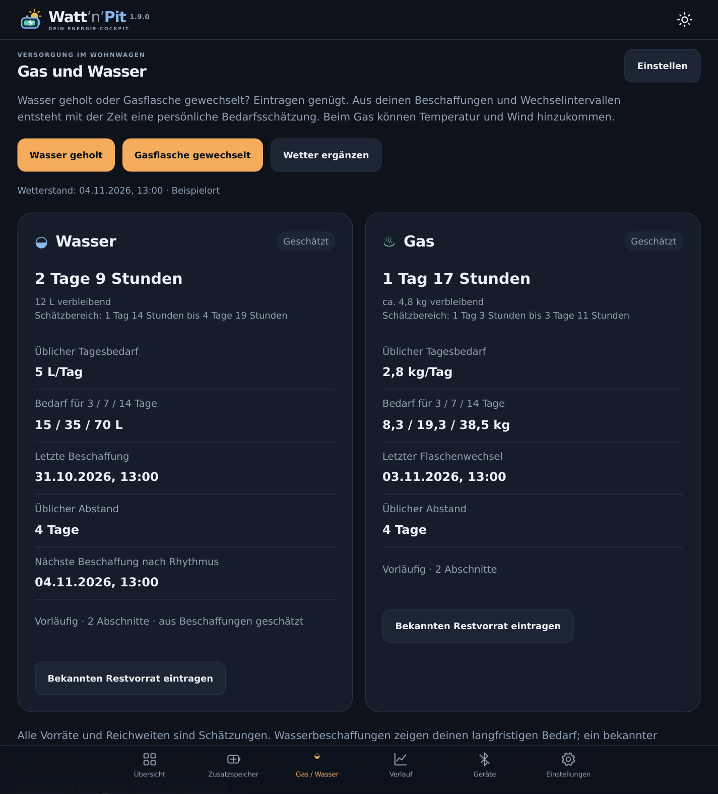
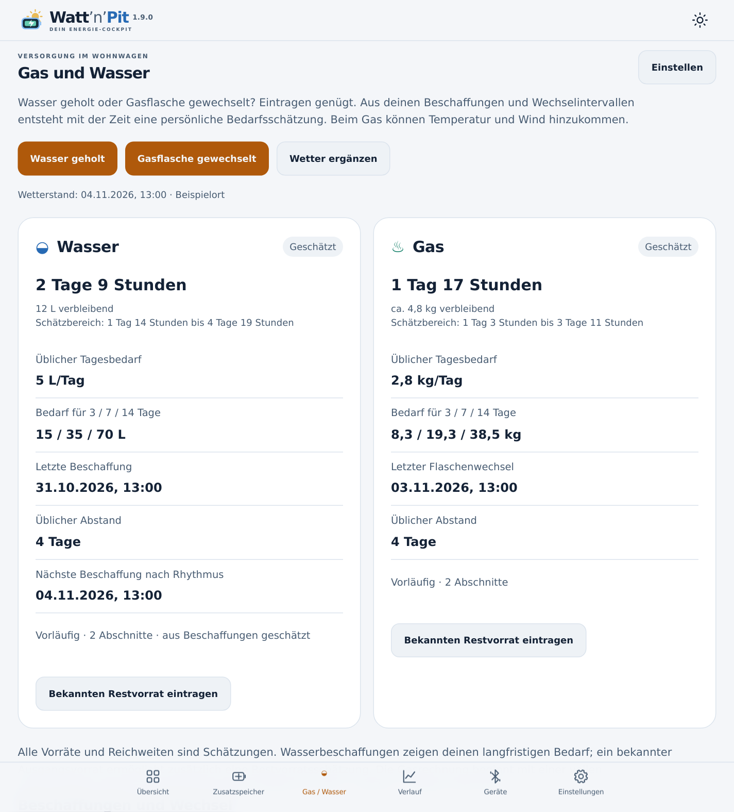
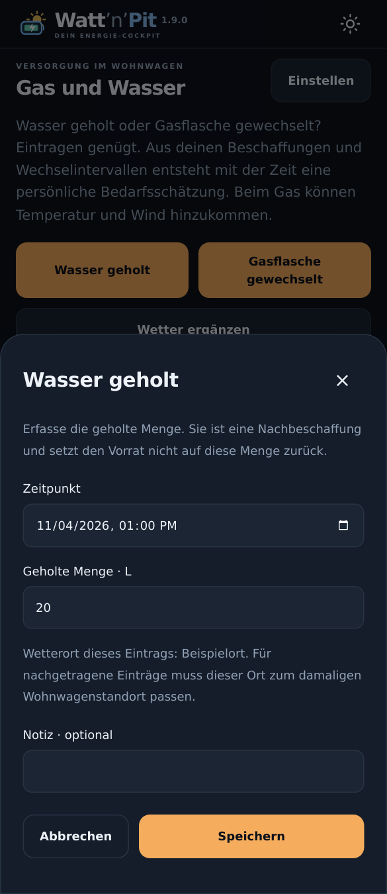

# Gas und Wasser – Watt’n’Pit 1.9.0 mit WohnPit 0.0.4

## Welche App macht was?

| Gerät / App | Aufgabe |
|---|---|
| G5 mit WohnPit ab 0.0.4 | Beschaffungen, Flaschenwechsel und bekannte Restvorräte speichern; Wettervorhersagen und Wetterrückblicke sammeln; den gemeinsamen Datenstand bereitstellen. |
| S20 / S10 mit Watt’n’Pit ab 1.9.0 | Einträge und Einstellungen bedienen; Verbrauchsmuster auswerten; Gas-/Wasserbedarf, Reichweite und Kacheln berechnen und anzeigen. |

Das G5 führt keine neue Gas-/Wasser-Lernberechnung aus. Eine laufende Aufzeichnung sammelt die Wetterdaten auch bei geschlossener Statusansicht. Der vorhandene Wetterort gilt für den Wohnwagen. Standortwechsel deshalb über die gemeinsame Wetter-/Anlageneinstellung erfassen, nicht den Aufenthaltsort eines gerade weggefahrenen Anzeigehandys verwenden.

## Aktualisieren

1. WohnPit **0.0.4** über die vorhandene WohnPit-Installation installieren.
2. Watt’n’Pit **1.9.0** auf S20 und S10 über die vorhandene App installieren.
3. Den bisherigen Anlagenverbund weiterverwenden. Nach dem Öffnen den neuen Menüpunkt **Gas / Wasser** wählen.

Geräte, Messwerte, bestehende Kopplungen und eigene Kachelanordnungen bleiben erhalten. Nicht vorher deinstallieren. Eine ältere Zentrale liefert die Energiedaten weiter; die neue Versorgungserfassung verlangt das WohnPit-Update. Watt’n’Pit funktioniert auch weiterhin direkt ohne WohnPit: In diesem Fall werden Einträge und Wetterdaten auf diesem Hauptgerät gespeichert.

## Wasser erfassen

**Gas / Wasser → Wasser geholt** öffnen. Vorgeschlagen werden **20 Liter**. Menge und Zeitpunkt prüfen, bei Bedarf eine Notiz ergänzen und **Speichern** antippen. Ein vergangener Zeitpunkt ist möglich. Über ein Anzeigehandy erscheint die Bestätigung erst, wenn die Zentrale den Eintrag dauerhaft gespeichert hat.

Eine Beschaffung ist eine hinzugeholte Menge. Sie bedeutet weder „Tank jetzt voll“ noch „jetzt genau 20 Liter vorhanden“. Der durchschnittliche Bedarf ergibt sich aus mehreren Beschaffungen und ihren Abständen; wechselnde Vorräte und unregelmäßige Einkäufe können einzelne Abschnitte verzerren. Die erste Beschaffung setzt eine Zeitgrenze. Die anschließend beschafften Mengen bilden die Verbrauchsnäherung für die folgenden Abschnitte. Ohne bekannten Ausgangsvorrat werden Bedarf und Beschaffungsrhythmus geschätzt; der Restvorrat und seine Reichweite bleiben offen.

Mit **Bekannten Restvorrat eintragen** lässt sich beispielsweise ein tatsächlich vorhandener Bestand von 12 Litern erfassen. Danach werden weitere Beschaffungen addiert und der geschätzte Verbrauch abgezogen. Einen Bestand nach einer Beschaffung inklusive dieser Menge erfassen. Auch ein tatsächlich leerer Vorrat kann mit **0 Litern** erfasst werden.

## Gas erfassen

**Gas / Wasser → Gasflasche gewechselt** öffnen. Vorgeschlagen werden **11 kg** für die neu eingesetzte volle Flasche. Die Menge lässt sich etwa für eine 5-kg-Flasche ändern. Zeitpunkt prüfen und speichern.

Der neue Flascheninhalt ist ein Ausgangsvorrat. Erst der nächste vollständige Wechsel liefert einen abgeschlossenen Verbrauchsabschnitt. Dafür zählt der Inhalt der vorherigen Flasche: Wird eine leere 11-kg-Flasche durch 5 kg ersetzt, werden dem abgeschlossenen Abschnitt 11 kg zugeordnet, der neue Vorrat beträgt 5 kg.

**Vorherige Flasche war leer** ist für den üblichen Wechsel vorausgewählt. Bei einem vorzeitigen Wechsel den Haken entfernen. Der unvollständige Abschnitt wird dann nicht als vollständig verbrauchter Flascheninhalt gelernt. Auch ein bekannter Restinhalt lässt sich gesondert erfassen. Eine Bestandskorrektur innerhalb eines Abschnitts nimmt diesen vorsichtshalber aus dem Lernen vollständiger Flaschen heraus.

## Einträge korrigieren und Standardmengen einstellen

Unter **Beschaffungen und Wechsel → Bearbeiten** lassen sich Menge, Zeitpunkt, Notiz und die Kennzeichnung eines vorzeitigen Gaswechsels ändern. **Löschen** öffnet eine Bestätigung; **Abbrechen** erhält den Eintrag. Die Auswertung wird aus den verbleibenden Daten neu berechnet. Einträge aus der Zukunft und ungültige Mengen werden abgewiesen. Wiederholte Übertragungen desselben Eintrags erzeugen keine zweite Beschaffung.

**Gas / Wasser → Einstellen** legt die Vorschlagsmengen für Wasser und Gas fest. Sie gelten für alle gekoppelten Anzeigen. Bereits erfasste Mengen werden dadurch nicht verändert. Bedienung und Änderungen erfolgen vollständig in Watt’n’Pit.

## Wetter und Lernen

In den gemeinsamen Einstellungen einen Wetterort festlegen. **Wetter ergänzen** fordert einen Abruf auf der Zentrale an. Ohne erteilte Wetterfreigabe wird kein Wetter abgerufen. Bei laufender Aufzeichnung prüft die Zentrale im Hintergrund, ob ein Abruf fällig ist; eine erfolgreiche Wettergrundlage wird grundsätzlich bis zu sechs Stunden wiederverwendet. Bei einem Ausfall bleiben die vorhandenen Daten erhalten. Die nächste Gelegenheit mit Internet ergänzt den Stand; manuell lässt sich früher erneut anfordern.

Erfasst werden Temperatur und Wind von Open-Meteo. Frühere Einträge erhalten Wetterrückblicke für den zugeordneten Ort und Zeitraum, zunächst bis zu ungefähr drei Jahren zurück. Große Rückblicke werden in begrenzten Paketen ergänzt. Ein fehlender Rückblick blockiert weder die Einträge noch die einfache Verbrauchsschätzung. Frühere Prognosen und spätere Wetterrückblicke bleiben getrennte Datensätze. Die Rückblicke sind modellierte Wetterdaten, keine Messung direkt am Wohnwagen. Verbrauchsmengen, Gaswechsel und Gerätekennungen werden nicht an den Wetterdienst übertragen.

Eine erste vorläufige Bedarfsschätzung ist nach einem abgeschlossenen Abschnitt möglich. Mehrere Abschnitte verbessern ihre Grundlage. Berücksichtigt werden bis zu 24 abgeschlossene Abschnitte aus den vergangenen 400 Tagen; die ursprünglichen Einträge werden dadurch nicht gelöscht.

Beim Gas wird ein Temperaturmodell frühestens mit sechs geeigneten, unterschiedlich kalten Abschnitten geprüft; ein zusätzliches Windmodell frühestens mit neun. Das Modell wird nur verwendet, wenn es zurückgehaltene Abschnitte besser erklärt als der durchschnittliche Verbrauch. Wetterlücken und erkennbare Ortswechsel verhindern eine unbelegte Wetterzuordnung. Ohne geeignetes Wettermodell bleibt die Schätzung aus den Wechselintervallen verfügbar. Wetterkorrekturen verwenden eine ausreichend aktuelle Vorhersage; außerhalb ihrer zeitlichen Abdeckung gilt wieder der übliche Bedarf.

## Anzeigen und zusätzliche Kacheln

Die Versorgungsseite zeigt den geschätzten Restvorrat, die Reichweite samt Schätzbereich, üblichen Tagesbedarf, Bedarf für **3 / 7 / 14 Tage**, letzten Eintrag und übliche Abstände. Beim Wasser wird außerdem der aus dem Beschaffungsrhythmus erwartete nächste Termin angezeigt. Dieser Termin ist eine Planungshilfe und kein gemessener Leerstand.

Die Reichweite wird in **Tagen und Stunden** angegeben, zum Beispiel **1 Tag 17 Stunden**. Unter einer Stunde steht **Weniger als 1 Stunde**. Fehlende Grundlagen erscheinen als **—**. Schätzbereiche sind Orientierung aus der Streuung bisheriger Abschnitte, keine garantierten Grenzen.

Unter **Übersicht → + Kachel → Wasser / Gas** sind frei wählbar:

| Wert | Einheit / Darstellung |
|---|---|
| Restvorrat | L / kg, geschätzt |
| Reichweite | Tage und Stunden |
| Tagesbedarf | L/Tag / kg/Tag |
| Bedarf für 3, 7 oder 14 Tage | L / kg |
| Seit letzter Beschaffung / letztem Flaschenwechsel | Tage und Stunden |
| Üblicher Abstand | Tage und Stunden |
| Wasser: bis zur nächsten Beschaffung | Tage und Stunden nach dem Beschaffungsrhythmus |

Es werden keine Versorgungskacheln ungefragt in vorhandene Übersichten eingefügt. Hinzugefügte Kacheln verwenden das bestehende Raster; Position, Größe, Beschriftung und Gestaltung bleiben je Anzeigehandy und Ausrichtung einstellbar. Zahlenwerte unterstützen auch Rundinstrumente. Tage-/Stundenkacheln haben eine ausreichende Mindestgröße, damit der vollständige Zeittext lesbar bleibt. Für noch nicht vorhandene Sensorwerte wird kein gemessener Verlauf vorgetäuscht.

## Verbindung, Speicherung und Grenzen

Bei unterbrochener Verbindung bleibt der letzte empfangene Stand sichtbar und wird gekennzeichnet. Neue Einträge brauchen eine Bestätigung der Zentrale; ein fehlgeschlagener oder überholter Befehl wird nicht als Erfolg dargestellt. Journal und Vorschlagsmengen gehören zur gemeinsamen Anlage, die Kachelanordnung zum jeweiligen Handy.

Das Journal bleibt bei einem normalen App-Update erhalten. Die bisherige Einstellungssicherung und der Energie-CSV-Export enthalten das Gas-/Wasserjournal noch nicht; sie sind keine vollständige Sicherung dieser neuen Daten. Nicht deinstallieren oder App-Daten löschen. Eine gesonderte Journal-Sicherung ist in dieser ersten Version noch nicht enthalten.

Die erste Version verwendet manuelle Angaben. Sie misst weder den Wasserstand noch das Gewicht einer Gasflasche. Mehrere gleichzeitig verwendete Gasflaschen werden zunächst als eine Abfolge aktiver Flaschen behandelt; ein separater Reserveflaschenbestand wird nicht geführt. Persönliche Gasnutzung, Heizungseinstellungen, Abwesenheit und Einkaufsverhalten können sich ändern. Die Anzeigen bleiben deshalb ausdrücklich geschätzt.

## Screenshots

Die folgenden Bilder stammen aus den ausgelieferten Oberflächendateien mit frei erfundenen Einträgen und einem neutralen Wetterort.

