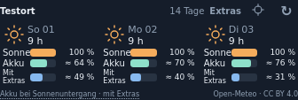
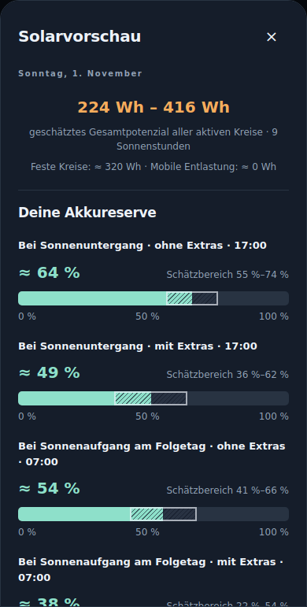

# Watt’n’Pit 1.8.0

Die Wetterkarte zeigt jetzt zwei getrennte Akkuszenarien. Ein eingeplanter Zusatzverbrauch kann die normale Prognose nicht mehr unbemerkt ersetzen. **Zuerst das Hauptgerät, danach alle Anzeigehandys aktualisieren.** Installation als Update mit der bisherigen Signatur; Messdaten und eigene Kachelanordnungen bleiben erhalten.

## Sonne, Akku und Mit Extras

- **Sonne:** Einstrahlung relativ zum besten Tag der Vorschau.
- **Akku:** Wohnwagenakku bei Sonnenuntergang mit dem üblichen Verbrauch, ohne zugeordnete Sondernutzungen.
- **Mit Extras:** Derselbe Wohnwagenakku mit den eingeplanten zusätzlichen Verbrauchern. Dieser Balken zeigt nicht den Rollerakku.

Beide Akkuszenarien beginnen beim aktuellen SmartShunt-Ladezustand und rechnen die Zeitabschnitte bis Sonnenuntergang beziehungsweise zum folgenden Sonnenaufgang durch. Eine Empfangslücke beim Roller lässt die normale Prognose unverändert. Ist der zusätzliche Ladebedarf nicht bestimmbar, stehen bei „Mit Extras“ ein Strich und eine Erklärung in der Tagesansicht. Auch ein späterer Tag bleibt unklar, wenn ein davorliegender unbekannter Zusatzbedarf seine Reserve beeinflusst.

## Sondernutzungen einrichten

Über **Extras** direkt in der Wetterkarte eine frei benannte Sondernutzung anlegen, zum Beispiel „Mikrowelle“ oder „Minibackofen“. Hinterlegen lassen sich Wh pro Tag oder Leistung und Nutzungsdauer sowie die übliche Startstunde. Ein Wh-Wert hat Vorrang vor Leistung × Dauer. Jeder Verbraucher kann für die Extras-Prognose berücksichtigt oder ausgenommen werden; die drei Balken benötigen keinen zusätzlichen Sichtbarkeitsschalter.

Unter **Nutzung erfassen** lassen sich bekannte vergangene Nutzungen und konkrete zukünftige Zeiten eintragen. Eine zukünftige Nutzung ersetzt die übliche Tagesannahme dieses Verbrauchers. Damit kann eine einmalige Ladung oder Nutzung geplant werden, ohne einen regelmäßigen Tagesbedarf doppelt aufzuschlagen. Angaben sind Planungen beziehungsweise eigene Erfassungen, keine automatisch isolierten Gerätemessungen. Die App schaltet keine Geräte.

Die Tagesansicht nennt die Verbraucher, ihren erwarteten Bedarf, den Bedarf einschließlich Extras und die entsprechende Bilanz. Solar und üblicher Bedarf beziehen sich auf den ganzen Vorschautag; geplante Extras werden ab dem aktuellen Zeitpunkt angesetzt. Für die Akkuvorschau gelten die tatsächlichen verbleibenden Zeitanteile.

## Bedarf lernen und Roller

Für allgemeine Verbraucher kann **Aus erfassten Nutzungstagen lernen** gewählt werden. Ab drei ausdrücklich erfassten Tagen wird der mittlere Tagesbedarf aus höchstens 28 bekannten Tagen der letzten 90 Tage verwendet. Ein bestätigter Tag ohne Nutzung kann mit 0 Wh eingetragen werden. Fehlende Tage zählen nicht als Nullnutzung.

Ein eingerichteter Roller erscheint automatisch als Sondernutzung. Er kann umbenannt und konfiguriert werden. Für eine eigene Fahrstreckenschätzung dienen **19 Wh/km** als veränderbarer Startwert. Der geschätzte Wohnwagenbedarf berücksichtigt zusätzlich das hinterlegte Wechselrichter-/Ladegerätprofil. Ein bereits gespeicherter individueller Fahrverbrauch bleibt erhalten.

Das automatische Rollerlernen nutzt zeitlich erfasste Ladeanteile an ausreichend beobachteten Tagen. Die Energie wird auch über Mitternacht dem jeweiligen Tag zugeordnet. Nicht zugeordnete Ladungen und unvollständige Ladeaufzeichnungen machen betroffene Tage ungeeignet. Mindestens drei Tage mit jeweils 20 Stunden beobachteter BMS-Verbindung sind nötig; unvollständige Ladungen machen den betreffenden Tag ungeeignet. Die dafür notwendige Beobachtungsdauer wird ab dieser Version gesammelt. Frühere nicht beobachtete Standtage werden nicht nachträglich als Tage ohne Nutzung ausgelegt. Ohne passende Grundlage bleibt die Schätzung offen; alternativ lässt sich ein eigener Tagesbedarf hinterlegen oder ein vollständiger bekannter Tagesbedarf manuell erfassen. Bestätigte manuelle Tageswerte haben Vorrang vor der automatischen Erfassung.

Der bisherige Haken **Ladung ab jetzt in der Akkuprognose einplanen** steht weiterhin für eine konkrete Restladung bis zum Ladeziel. Während einer Ladeaufzeichnung gilt diese konkrete Planung automatisch. Sie hat im betroffenen Zeitraum Vorrang vor der üblichen Rollerschätzung und wird in der Tagesansicht als solche benannt. Der übrige regelmäßige Bedarf an späteren Tagen wird separat bewertet.

Aufgezeichnete Rollerladungen bleiben nach dem bestehenden Verfahren vom normalen Verbrauchslernen getrennt: Zeitlich passende BMS-Ladeanteile werden mit geschätzten Verlusten abgezogen, bei fehlender Zuordnung werden die Ladezeiten ausgeschlossen. Manuell zugeordnete sonstige Nutzungszeiten werden ebenfalls nur beim Lernen des normalen Bedarfs ausgespart. Die tatsächlichen Messwerte und der Gesamtverbrauch bleiben vollständig erhalten.

Sondernutzungen und erfasste Zeiten gehören zur Anlage. Änderungen von einem Anzeigehandy werden erst nach Bestätigung der Zentrale übernommen und bei deren lokaler Verbrauchsauswertung berücksichtigt. Eigene Kachelanordnungen bleiben pro Handy erhalten. Die Sondernutzungen werden auch in der Einstellungssicherung mitgeführt.

## Ertragslernen

Bisher konnte eine einzelne ungeeignete helle Teilzeit den gesamten Tagesabschnitt vom Ertragslernen ausschließen. Neue Vorhersagen speichern zusätzlich die ursprünglichen Stundenwerte. Mindestens 30 Minuten geeignete, nicht begrenzte Messzeit mit mindestens 20 Wh vorhergesagtem Vergleichsertrag können nun gemeinsam einen Vergleichstag liefern, auch wenn andere Stunden fehlen oder begrenzt waren. Die örtliche Korrektur benötigt weiterhin mindestens drei geeignete Tage je Abschnitt. Die Tagesansicht nennt die Zahl geeigneter Vergleichstage.

Ältere Vorhersagen ohne Stundenaufteilung erhalten keine erfundene nachträgliche Form: Für sie gelten weiterhin die vollständigen Vergleichsabschnitte. Neue vergleichbare Prognosen und Messungen müssen daher zunächst zusammenkommen. Fehlende Ladephasen- oder Reglereinstellungen werden nicht als Beleg einer unbegrenzten Erzeugung behandelt. Bei mindestens zehn geeigneten Tagen kann eine dauerhaft belegte größere Modellabweichung über die bisherige obere 50-Prozent-Grenze hinaus korrigiert werden; die Korrektur bleibt begrenzt.

## Prüfung und Grenzen

202 JavaScript-Prüfungen einschließlich unabhängiger Akkuszenarien, Empfangslücken, Mitternachtsgrenzen, konkreter Planung ohne Doppelzählung, bestätigter Nullnutzung, Ladeverlusten und teilweisem Solarlernen. Native SQLite-Prüfungen prüfen zugeordnete Sondernutzungen bei unveränderten Messwerten, getrennte Lernzeiten und gültige Solar-Teilabschnitte. Verbundprüfungen vergleichen zwei unabhängige Anzeigen mit den Eingaben der Zentrale. Browserprüfungen decken Tagesbudget, drei Balken, frei benannte Verbraucher, bestätigte Änderungen von Anzeigen sowie schmale/breite und helle/dunkle Ansichten ab. Der Android-Build führt außerdem Unit-Tests und Lint aus.

Die automatische Erkennung allgemeiner Geräte allein aus dem Shunt-Gesamtverbrauch ist nicht enthalten. Ladeverluste bleiben eine Schätzung aus dem konfigurierten Profil. Eine uneingeschränkte Aussage über den Betrieb auf einem physischen G5 oder über tatsächliches Wetter und Nutzungsverhalten liefern die automatisierten Prüfungen nicht.
